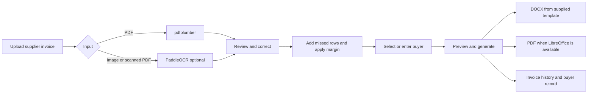
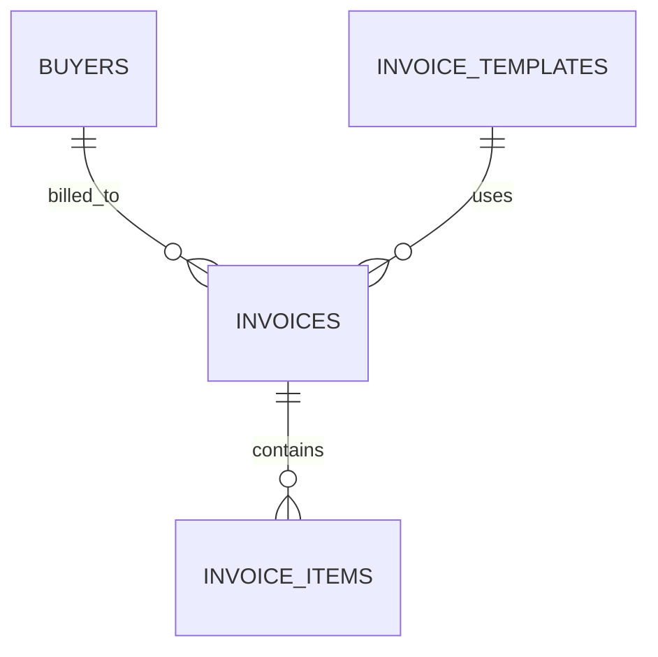

# Shah Enterprises Invoice Generator

> Turn a manufacturer invoice into a reviewed, customer-ready invoice—without losing control of the data or the document template.


An invoice workflow for **Shah Enterprises**: upload a supplier invoice, extract and correct its line items, apply internal margins, select or save a buyer, and generate downloadable DOCX/PDF files.

## Contents

- [What it does](#what-it-does)
- [Invoice workflow](#invoice-workflow)
- [Extraction and review](#extraction-and-review)
- [Pricing and customer-data boundary](#pricing-and-customer-data-boundary)
- [Documents and storage](#documents-and-storage)
- [Database model](#database-model)
- [Run locally](#run-locally)
- [Configuration](#configuration)
- [API reference](#api-reference)
- [Project map](#project-map)

## What it does

| Area | Capabilities |
|---|---|
| **Invoice intake** | Upload PDF, JPG/JPEG, PNG, or WEBP supplier invoices. |
| **Extraction** | Use `pdfplumber` for PDFs and optional PaddleOCR for image/scanned input. |
| **Review** | Edit extracted fields, add missed product rows, and review totals before generation. |
| **Margins** | Calculate selling rates and profit internally, with a global margin action. |
| **Buyer directory** | Search saved buyers while entering invoice details; new buyers are saved after successful generation. |
| **History** | Browse generated invoices and download available DOCX/PDF files. Open a buyer to see their invoice history. |
| **Document generation** | Fill the supplied DOCX template and optionally convert it to PDF. |

## Invoice workflow



### Creating an invoice

1. Upload a supplier invoice and run extraction.
2. Review the extracted item table. Correct values or use **Add Row** when the parser missed a product.
3. Enter invoice details and choose a saved buyer from the suggestions, or enter a new buyer’s name and GST number.
4. Apply a global margin if appropriate, then inspect the preview.
5. Generate the invoice. The app saves the invoice and its items in PostgreSQL, then creates the document files.
6. Download the available files from the completion screen, **Invoice History**, or the buyer’s detail page.

### Buyer behavior

- Typing a buyer name displays matching saved buyers; selecting one fills the buyer name and GST details and links the buyer record to the invoice.
- If no saved buyer is selected, the app creates or reuses a matching buyer only after invoice generation succeeds.
- Selecting a buyer in the **Buyers** directory opens that buyer’s invoice history, including dates, totals, statuses, and available downloads.
- Older invoices without a buyer ID can also appear in buyer history when their buyer name matches.

## Extraction and review

| Source | Extraction path |
|---|---|
| Digital PDF | `pdfplumber` table extraction, with text parsing as a fallback. |
| Scanned PDF | OCR is attempted when the PDF extractor returns no items. |
| Image | PaddleOCR, when the optional dependency is installed. |
| Any source | Review is editable before invoice generation; item rows can be added manually. |

The PDF table extractor normalizes common column headings (for example, `DESCRIPTION` → `item_name`, `QTY` → `qty`, and `HSN/SAC` → `hsn_code`). Product rows are distinguished from tax summaries and totals so GST breakdowns are not treated as products. OCR results use heuristics and should be checked in the review step.

## Pricing and customer-data boundary

The app keeps internal pricing separate from the customer-facing document.

| Internal invoice data | Customer-facing invoice |
|---|---|
| `purchase_rate` | `item_name` |
| `margin_percent` | `hsn_code` |
| `estimated_profit` | `qty`, `unit` |
| Internal purchase totals | `selling_rate`, `amount` |

> [!IMPORTANT]
> The DOCX generator writes the selling rate—not the purchase rate, margin, or estimated profit—to the customer invoice. Margin and profit fields are internal application data.

For each item:

```text
selling_rate = purchase_rate × (1 + margin_percent / 100)
amount       = selling_rate × qty
```

## Documents and storage

- **DOCX:** Generated by filling [`backend/templates/invoice_template.docx`](backend/templates/invoice_template.docx) directly. The template’s layout and formatting are preserved; invoices are not recreated as HTML/CSS.
- **PDF:** Converted from the DOCX with LibreOffice when available. PDF conversion is optional; DOCX generation is independent.
- **Generated files:** Stored in `backend/generated/`. The database stores each generated filename, not the document binary.
- **Source uploads:** Stored in `backend/uploads/`.
- **Directories:** The backend creates configured upload, generated, and template directories on startup.

## Database model



| Table | Stored information |
|---|---|
| `buyers` | Buyer name, GST number, contact details, and address. |
| `invoices` | Invoice identifiers, buyer association, tax settings, totals, status, and generated-file names. |
| `invoice_items` | Product rows, selling values, and internal purchase/margin/profit values. |
| `invoice_templates` | Template metadata. |

## Run locally

### Prerequisites

- Node.js **20.9 or newer**
- Python **3.11**
- PostgreSQL **14 or newer**
- LibreOffice (optional; required for PDF conversion)

### 1. Create the database

Create the database using your local PostgreSQL role:

```bash
createdb shah_invoices
```

If you use a different database name, update `DATABASE_URL` in the backend environment file.

### 2. Configure and run the backend

```bash
cd backend
cp .env.example .env
# Edit .env and set DATABASE_URL to your PostgreSQL credentials.
python3.11 -m venv venv
source venv/bin/activate
python -m pip install -r requirements.txt
uvicorn app.main:app --reload
```

The API is available at `http://localhost:8000`. Interactive API documentation is at [`http://localhost:8000/api/docs`](http://localhost:8000/api/docs).

### 3. Run the frontend

In another terminal:

```bash
cd frontend
npm install
npm run dev
```
App runs at: http://localhost:3000

---

## 📁 Project Structure

```
Invoice Generator/
├── backend/
│   ├── app/
│   │   ├── main.py                        # FastAPI app entry point
│   │   ├── core/config.py                 # Settings & environment
│   │   ├── db/database.py                 # SQLAlchemy engine & session
│   │   ├── models/models.py               # ORM models
│   │   ├── schemas/schemas.py             # Pydantic schemas
│   │   ├── api/routes/
│   │   │   ├── upload.py                  # POST /upload
│   │   │   ├── extract.py                 # POST /extract, /apply-margin
│   │   │   ├── invoices.py                # CRUD + /generate + /dashboard
│   │   │   ├── buyers.py                  # Buyer CRUD
│   │   │   └── templates.py               # Templates listing
│   │   └── services/
│   │       ├── extraction/
│   │       │   ├── pipeline.py            # Master extraction orchestrator
│   │       │   ├── pdf_extractor.py       # pdfplumber table + text extraction
│   │       │   ├── ocr_extractor.py       # PaddleOCR fallback
│   │       │   └── normalizer.py          # Column name normalization engine
│   │       ├── docx/generator.py          # python-docx template filling
│   │       ├── pdf/converter.py           # LibreOffice headless PDF export
│   │       └── margin_calculator.py       # Profit margin engine
│   ├── templates/invoice_template.docx    # Master DOCX template
│   ├── uploads/                           # Manufacturer invoice uploads
│   ├── generated/                         # Generated customer invoices
│   └── requirements.txt
│
├── frontend/
│   └── src/
│       ├── app/
│       │   ├── page.tsx                   # Dashboard
│       │   ├── new-invoice/page.tsx       # Upload → Review → Preview → Done
│       │   ├── history/page.tsx           # Invoice history
│       │   ├── buyers/page.tsx            # Buyer directory
│       │   ├── invoice/[id]/page.tsx      # Invoice detail
│       │   ├── profit/page.tsx            # Internal profit overview
│       │   ├── templates/page.tsx         # Template management
│       │   └── settings/page.tsx          # System settings
│       ├── components/
│       │   ├── layout/Sidebar.tsx         # Navigation sidebar
│       │   ├── layout/AppLayout.tsx       # Page shell
│       │   └── invoice/
│       │       ├── UploadStep.tsx         # Drag-drop + extraction progress
│       │       ├── ReviewStep.tsx         # Spreadsheet-like editable table
│       │       ├── PreviewStep.tsx        # Customer invoice preview
│       │       └── DoneStep.tsx           # Generate DOCX/PDF
│       ├── store/invoiceStore.ts          # Zustand workflow state
│       └── lib/
│           ├── api.ts                     # Axios API client
│           └── utils.ts                   # Formatters & utilities
│
├── reference_files/                       # Master template + sample invoices
├── docker-compose.yml
└── README.md
```

---

## ⚙️ Extraction Pipeline

The system handles any manufacturer invoice format:

```
1. pdfplumber → table extraction (digital PDFs)
2. pdfplumber → text parsing (no visible tables)
3. PaddleOCR  → scanned PDFs and images (fallback)
4. Manual entry → always available as last resort
```

**Column Normalization:** Maps any variation to standard fields:
- "DESCRIPTION" / "ITEM NAME" / "GOODS" → `item_name`
- "QTY" / "QUANTITY" / "NOS" → `qty`
- "RATE" / "UNIT PRICE" / "PRICE" → `purchase_rate`
- "HSN/SAC" / "HS CODE" → `hsn_code`

---

## 💰 Margin Formula

```
selling_rate = purchase_rate × (1 + margin_percent / 100)
amount       = selling_rate × qty
```

---

## 🔒 DOCX Template Placeholders

Add these to `invoice_template.docx`:

| Placeholder | Value |
|---|---|
| `{{invoice_no}}` | Invoice number |
| `{{invoice_date}}` | Invoice date |
| `{{buyer_name}}` | Buyer name |
| `{{buyer_gst}}` | Buyer GSTIN |
| `{{country_of_shipment}}` | Country |
| `{{transport_mode}}` | Transport mode |
| `{{subtotal}}` | Subtotal |
| `{{igst_amount}}` | IGST amount |
| `{{total_amount}}` | Final total |
| `{{amount_in_words}}` | Amount in words |

---

## 🗄️ Database Schema

| Table | Purpose |
|---|---|
| `invoices` | Invoice header + financial totals |
| `invoice_items` | Line items (includes internal profit fields) |
| `buyers` | Customer directory |
| `invoice_templates` | Template management |

---

## 🌐 API Endpoints

| Method | Endpoint | Description |
|---|---|---|
| POST | `/api/upload` | Upload manufacturer invoice |
| POST | `/api/extract?file_id=...` | Run extraction pipeline |
| POST | `/api/apply-margin` | Calculate selling rates |
| POST | `/api/invoices` | Create invoice |
| GET | `/api/invoice/:id` | Get invoice details |
| PUT | `/api/invoice/:id` | Update invoice |
| DELETE | `/api/invoice/:id` | Delete invoice |
| POST | `/api/generate` | Generate DOCX + PDF |
| GET | `/api/history` | Invoice list |
| GET | `/api/dashboard` | Dashboard statistics |
| GET | `/api/buyers` | Buyer list |

---

## 🐳 Docker

```bash
cd backend
source venv/bin/activate
pip install paddleocr paddlepaddle
```

For PDF generation on macOS, install LibreOffice:

```bash
brew install --cask libreoffice
```

## Configuration

Backend settings are read from `backend/.env`. Start with [`backend/.env.example`](backend/.env.example).

| Setting | Purpose |
|---|---|
| `DATABASE_URL` | PostgreSQL connection string. |
| `UPLOAD_DIR` | Source invoice upload directory. |
| `GENERATED_DIR` | Generated DOCX/PDF directory. |
| `TEMPLATE_DIR` | Directory containing the DOCX template. |
| `MAX_UPLOAD_SIZE_MB` | Maximum upload size; defaults to 20 MB. |
| `ALLOWED_EXTENSIONS` | Accepted upload extensions. |
| `CORS_ORIGINS` | Allowed frontend origins. |
| `NEXT_PUBLIC_API_URL` | Frontend API base URL; defaults to `http://localhost:8000/api`. |

Keep local `.env` files and database credentials out of version control.

## API reference

All backend endpoints are prefixed with `/api`.

| Method | Endpoint | Purpose |
|---|---|---|
| `POST` | `/upload` | Upload a supplier invoice. |
| `POST` | `/extract?file_id=…` | Extract items from an uploaded file. |
| `POST` | `/apply-margin` | Calculate selling values for reviewed items. |
| `POST` | `/invoices` | Save an invoice and its items. |
| `GET` | `/invoices` | List invoices. |
| `GET` | `/history` | List invoice history. |
| `GET` | `/invoice/{id}` | Get an invoice and its items. |
| `PUT` | `/invoice/{id}` | Update an invoice. |
| `DELETE` | `/invoice/{id}` | Delete an invoice. |
| `POST` | `/generate` | Generate DOCX, PDF, or both for a saved invoice. |
| `GET` | `/invoice/{id}/download/{file_type}` | Download an available DOCX or PDF (`file_type`: `docx` or `pdf`). |
| `POST` | `/invoice/{id}/buyer` | Create/reuse and link a buyer after successful generation. |
| `GET` | `/buyers` | List saved buyers. |
| `POST` | `/buyers` | Create a buyer manually. |
| `GET` | `/buyers/{id}` | Get buyer information. |
| `GET` | `/buyers/{id}/invoices` | List invoices associated with a buyer. |
| `PUT` | `/buyers/{id}` | Update a buyer. |
| `DELETE` | `/buyers/{id}` | Deactivate a buyer. |
| `GET` | `/templates` | List invoice templates. |
| `GET` | `/templates/{id}` | Get invoice template metadata. |
| `GET` | `/dashboard` | Get dashboard statistics. |
| `GET` | `/health` | Check API and dependency status. |

## Project map

```text
backend/
├── app/
│   ├── api/routes/          # Upload, extraction, invoice, buyer, and template APIs
│   ├── core/config.py       # Environment-backed settings
│   ├── db/database.py       # SQLAlchemy engine and sessions
│   ├── models/              # PostgreSQL ORM models
│   ├── schemas/             # Pydantic request/response models
│   └── services/
│       ├── extraction/      # PDF/OCR extraction and normalization
│       ├── docx/            # Template-driven DOCX generation
│       └── pdf/             # DOCX-to-PDF conversion
├── templates/
│   └── invoice_template.docx
├── uploads/                 # Uploaded source invoices
└── generated/               # Generated customer documents

frontend/src/
├── app/
│   ├── new-invoice/         # Upload → review → preview → completion
│   ├── history/             # Invoice list and downloads
│   └── buyers/              # Buyer directory and buyer invoice history
├── components/invoice/      # Invoice workflow screens
├── lib/api.ts               # Axios API client and application types
└── store/invoiceStore.ts    # Zustand invoice workflow state
```

---
