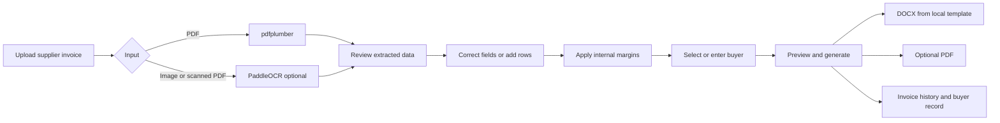

# Shah Enterprises Invoice Generator

> Review supplier invoices, prepare customer invoices, and download DOCX/PDF documents from one workflow.


The application extracts line items from supplier invoices, lets you correct or add rows, applies internal margins, and generates a customer-facing invoice from a locally supplied DOCX template.

## Contents

- [Features](#features)
- [Invoice workflow](#invoice-workflow)
- [Private company template](#private-company-template)
- [Extraction and review](#extraction-and-review)
- [Pricing and customer-data boundary](#pricing-and-customer-data-boundary)
- [Storage](#storage)
- [Run locally](#run-locally)
- [Configuration](#configuration)
- [API reference](#api-reference)
- [Project map](#project-map)

## Features

| Area | What it provides |
|---|---|
| **Invoice intake** | Upload PDF, JPG/JPEG, PNG, or WEBP supplier invoices. |
| **Extraction** | `pdfplumber` for PDFs and optional PaddleOCR for images/scanned PDFs. |
| **Review** | Edit extracted values, add missed product rows, and review totals. |
| **Margins** | Calculate selling rates and profit internally, including a global-margin action. |
| **Buyer directory** | Search and select saved buyers; new buyers are saved after invoice generation succeeds. |
| **Invoice history** | Browse generated invoices and download available DOCX/PDF files. |
| **Buyer history** | Open a buyer to see their invoices, totals, dates, status, and downloads. |
| **Document generation** | Fill a DOCX template directly and optionally convert it to PDF. |

## Invoice workflow



### Create an invoice

1. Provide the local company DOCX template as described in [Private company template](#private-company-template).
2. In the app, open **New Invoice** and upload the supplier invoice you want to process.
3. Review the extracted items. Correct fields or use **Add Row** if a product was missed.
4. Enter invoice details. Choose a saved buyer from the suggestions or enter a new buyer’s name and GST number.
5. Apply a margin if needed, then review the customer-facing preview.
6. Generate the invoice and download available files from the completion screen or **Invoice History**.

### Buyers

- Matching saved buyers appear while entering the buyer name. Selecting one fills its name and GST number and associates it with the invoice.
- If no saved buyer is selected, the app creates or reuses the buyer only after invoice generation succeeds.
- Buyer detail pages list associated invoices. Older invoices without a buyer ID are also matched by buyer name.

## Private company template

The company-specific invoice template is **not included in this repository**. Supply your own authorized DOCX template locally before generating customer invoices:

```bash
mkdir -p backend/templates
cp /path/to/your-company-template.docx backend/templates/invoice_template.docx
```

The generator loads the file at `backend/templates/invoice_template.docx`. This path is ignored by Git so your private template is not added to commits.

> [!NOTE]
> The supplier invoice uploaded through **New Invoice** is source material for extraction. It does not replace the company DOCX template. There is currently no in-app company-template upload flow; place the template at the path above.

The DOCX generator expects a compatible table layout and fills known cells/rows while preserving the template’s formatting. See [`backend/app/services/docx/generator.py`](backend/app/services/docx/generator.py) before adapting a different template layout.

## Extraction and review

| Source | Extraction path |
|---|---|
| Digital PDF | `pdfplumber` table extraction, with text parsing as a fallback. |
| Scanned PDF | OCR is attempted when PDF extraction returns no items. |
| Image | PaddleOCR, when the optional dependency is installed. |
| Any source | Review is editable; rows can be added manually before generation. |

The PDF table extractor normalizes common column headings, such as `DESCRIPTION` → `item_name`, `QTY` → `qty`, and `HSN/SAC` → `hsn_code`. It distinguishes product rows from GST summaries and totals. OCR uses heuristics, so verify recognized values in the review step.

## Pricing and customer-data boundary

Purchase and margin data is internal application data. Customer-facing documents contain selling values only.

| Internal fields | Customer invoice fields |
|---|---|
| `purchase_rate` | `item_name` |
| `margin_percent` | `hsn_code` |
| `estimated_profit` | `qty`, `unit` |
| Purchase totals | `selling_rate`, `amount` |

> [!IMPORTANT]
> The DOCX generator must never write `purchase_rate`, `margin_percent`, or `estimated_profit` into the customer invoice.

```text
selling_rate = purchase_rate × (1 + margin_percent / 100)
amount       = selling_rate × qty
```

## Storage

| Data | Location |
|---|---|
| Invoice headers, line items, buyers, and file-name metadata | PostgreSQL |
| Uploaded supplier invoices | `backend/uploads/` |
| Generated customer DOCX/PDF files | `backend/generated/` |
| Company DOCX template | Local-only `backend/templates/invoice_template.docx` |

The database stores generated file names; the DOCX/PDF binaries are stored on disk. Backend startup creates the configured upload, generated, and template directories if needed.

## Run locally

### Prerequisites

- Node.js **20.9 or newer**
- Python **3.11**
- PostgreSQL **14 or newer**
- LibreOffice (optional; required for PDF conversion)

### 1. Create a PostgreSQL database

```bash
createdb shah_invoices
```

If you use another database name or PostgreSQL role, update `DATABASE_URL` in `backend/.env`.

### 2. Configure and run the backend

```bash
cd backend
cp .env.example .env
# Edit .env and set DATABASE_URL to your PostgreSQL credentials.
python3.11 -m venv venv
source venv/bin/activate
python -m pip install -r requirements.txt
uvicorn app.main:app --reload
```

Keep the backend running. The API is available at `http://localhost:8000`; interactive documentation is at [`http://localhost:8000/api/docs`](http://localhost:8000/api/docs).

### 3. Run the frontend

In another terminal:

```bash
cd frontend
npm install
npm run dev
```

Open [`http://localhost:3000`](http://localhost:3000). The frontend defaults to `http://localhost:8000/api`; set `NEXT_PUBLIC_API_URL` in `frontend/.env.local` if your backend uses another address.

### Optional: OCR and PDF support

PaddleOCR is not part of the default backend requirements. Install a PaddleOCR/PaddlePaddle combination compatible with your operating system and Python environment:

```bash
cd backend
source venv/bin/activate
pip install paddleocr paddlepaddle
```

On macOS, install LibreOffice to enable PDF conversion:

```bash
brew install --cask libreoffice
```

## Configuration

Backend settings are read from `backend/.env`; start with [`backend/.env.example`](backend/.env.example).

| Setting | Purpose |
|---|---|
| `DATABASE_URL` | PostgreSQL connection string. |
| `UPLOAD_DIR` | Source invoice upload directory. |
| `GENERATED_DIR` | Generated DOCX/PDF directory. |
| `TEMPLATE_DIR` | Directory containing the local DOCX template. |
| `MAX_UPLOAD_SIZE_MB` | Maximum upload size; defaults to 20 MB. |
| `ALLOWED_EXTENSIONS` | Accepted upload extensions. |
| `CORS_ORIGINS` | Allowed frontend origins. |
| `NEXT_PUBLIC_API_URL` | Frontend API base URL; defaults to `http://localhost:8000/api`. |

Never commit `.env` files, database credentials, or your private company template.

## API reference

All backend endpoints are prefixed with `/api`.

| Method | Endpoint | Purpose |
|---|---|---|
| `POST` | `/upload` | Upload a supplier invoice. |
| `POST` | `/extract?file_id=…` | Extract items from an uploaded file. |
| `POST` | `/apply-margin` | Calculate selling values for reviewed items. |
| `POST` | `/invoices` | Save an invoice and its line items. |
| `GET` | `/invoices` | List invoices. |
| `GET` | `/history` | List invoice history. |
| `GET` | `/invoice/{id}` | Get an invoice and its items. |
| `PUT` | `/invoice/{id}` | Update an invoice. |
| `DELETE` | `/invoice/{id}` | Delete an invoice. |
| `POST` | `/generate` | Generate DOCX, PDF, or both for a saved invoice. |
| `GET` | `/invoice/{id}/download/{file_type}` | Download an available DOCX or PDF. |
| `POST` | `/invoice/{id}/buyer` | Create/reuse and link a buyer after successful generation. |
| `GET` | `/buyers` | List saved buyers. |
| `POST` | `/buyers` | Create a buyer manually. |
| `GET` | `/buyers/{id}` | Get buyer information. |
| `GET` | `/buyers/{id}/invoices` | List invoices associated with a buyer. |
| `PUT` | `/buyers/{id}` | Update a buyer. |
| `DELETE` | `/buyers/{id}` | Deactivate a buyer. |
| `GET` | `/templates` | List invoice templates. |
| `GET` | `/templates/{id}` | Get invoice template metadata. |
| `GET` | `/dashboard` | Get dashboard statistics. |
| `GET` | `/health` | Check API and dependency status. |

## Project map

```text
backend/
├── app/
│   ├── api/routes/          # Upload, extraction, invoice, buyer, and template APIs
│   ├── core/config.py       # Environment-backed settings
│   ├── db/database.py       # SQLAlchemy engine and sessions
│   ├── models/              # PostgreSQL ORM models
│   ├── schemas/             # Pydantic request/response models
│   └── services/
│       ├── extraction/      # PDF/OCR extraction and normalization
│       ├── docx/            # Template-driven DOCX generation
│       └── pdf/             # DOCX-to-PDF conversion
├── templates/               # Local-only; add your own invoice_template.docx
├── uploads/                 # Uploaded supplier invoices
└── generated/               # Generated customer documents

frontend/src/
├── app/
│   ├── new-invoice/         # Upload → review → preview → completion
│   ├── history/             # Invoice list and downloads
│   └── buyers/              # Buyer directory and buyer invoice history
├── components/invoice/      # Invoice workflow screens
├── lib/api.ts               # Axios API client and application types
└── store/invoiceStore.ts    # Zustand invoice workflow state
```
